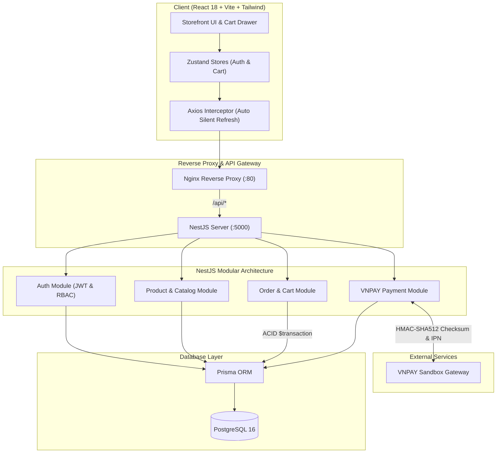
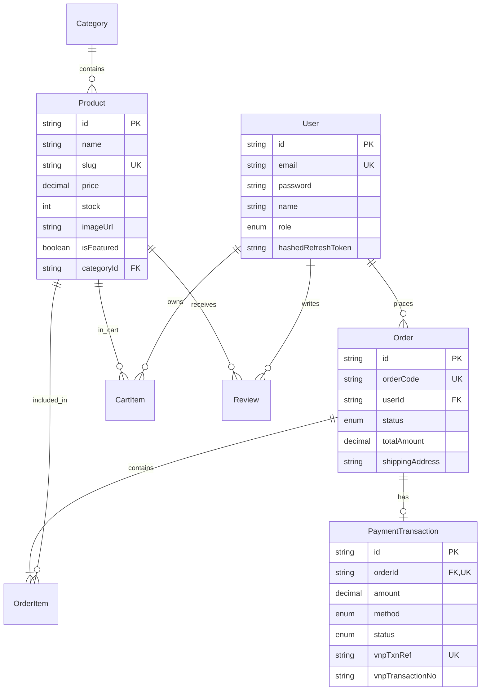

# 🛍️ ShopVerse - Enterprise Full-Stack E-Commerce Platform

> **ShopVerse** là hệ thống thương mại điện tử Full-stack chuẩn mực doanh nghiệp, giải quyết trọn vẹn bài toán xác thực phân quyền bảo mật, quản lý danh mục sản phẩm quy mô lớn, xử lý giao dịch đặt hàng chống Race Condition và tích hợp thanh toán trực tuyến qua cổng VNPAY Sandbox với mã hóa checksum HMAC-SHA512. Dự án được thiết kế theo kiến trúc Clean Modular Architecture, kiểm thử tự động với Jest và đóng gói toàn diện bằng Docker & CI/CD GitHub Actions.

[](https://github.com)
[](https://nestjs.com)
[](https://react.dev)
[](https://postgresql.org)
[](https://prisma.io)
[](https://vnpay.vn)
[](LICENSE)

---

## 📸 1. Live Demo & Screenshots

- **Live Frontend Demo**: `http://localhost:5173` (Local Dev) hoặc `http://localhost:80` (Docker Container)
- **Interactive Swagger OpenAPI**: `http://localhost:5000/api/docs`
- **Health Check Endpoint**: `http://localhost:5000/api/v1/health`


---

## 🛠️ 2. Tech Stack Chi Tiết

| Phân tầng | Công nghệ / Thư viện | Mục đích sử dụng |
| :--- | :--- | :--- |
| **Front-end** | React 18, Vite, TypeScript | Single Page Application tốc độ cao, type-safe |
| **Styling & UI** | Tailwind CSS, Lucide Icons | Giao diện Responsive hiện đại, tối ưu trải nghiệm UX |
| **State & Cache** | Zustand, TanStack Query | Quản lý Global State (Auth, Cart) & Cache API bất đồng bộ |
| **HTTP Client** | Axios (Custom Interceptors) | Tự động đính kèm Bearer Token & Auto Refresh Token ngầm (401) |
| **Back-end** | NestJS (TypeScript), SWC | Kiến trúc Modular Monolith chuẩn IoC / Dependency Injection |
| **Database & ORM**| PostgreSQL 16, Prisma ORM | RDBMS quan hệ chuẩn ACID, Type-safe Query Builder, Auto Migrations |
| **Bảo mật (Auth)** | Passport.js, JWT Dual-token, bcryptjs | Access Token (15m) + Refresh Token Rotation (7d) có mã hóa hash |
| **Payment Gateway**| VNPAY Sandbox SDK | Tạo URL thanh toán, xác thực chữ ký số HMAC-SHA512, Return URL & IPN |
| **DevOps & CI/CD** | Docker, Docker Compose, GitHub Actions | Multi-stage Dockerfile, container hóa DB + API + Client, tự động Test & Build |
| **Kiểm thử** | Jest, Supertest | Unit Tests bao phủ AuthService, ProductsService, OrdersService |

---

## ✨ 3. Key Features (Tính Năng Cốt Lõi)

- **Authentication & RBAC**:
  - Đăng ký, đăng nhập với cơ chế **Dual-token** (Access Token ngắn hạn + Refresh Token dài hạn lưu dạng bcrypt hash trong database).
  - Phân quyền theo vai trò (Role-Based Access Control): Guard `@Roles(Role.ADMIN)` bảo vệ các endpoint quản trị sản phẩm và cập nhật đơn hàng.
  - Tự động Refresh Token ngầm trên Client khi Access Token hết hạn mà không gây gián đoạn phiên làm việc của người dùng.
- **Product Catalog, Search & Filtering**:
  - Tìm kiếm toàn văn theo tên và mô tả sản phẩm (Full-text/ILIKE query).
  - Lọc đa tiêu chí: Lọc theo danh mục (ID hoặc Slug), khoảng giá (`minPrice`, `maxPrice`), sản phẩm nổi bật (`isFeatured`).
  - Sắp xếp linh hoạt: Mới nhất, giá tăng dần, giá giảm dần, theo thứ tự alphabet.
  - Phân trang chuẩn hóa (Pagination): Trả về dữ liệu kèm metadata (`page`, `limit`, `totalItems`, `totalPages`, `hasNextPage`, `hasPreviousPage`).
- **Shopping Cart & Atomic Checkout**:
  - Quản lý giỏ hàng đồng bộ Database (cho tài khoản đăng nhập) và Local Fallback (cho khách vãng lai).
  - Đặt hàng an toàn bằng **Database Transaction (`prisma.$transaction`)**: Kiểm tra tồn kho tại thời điểm checkout, trừ tồn kho tự động. Chống hiện tượng **Race Condition** khi nhiều người cùng đặt món hàng cuối cùng.
  - Hủy đơn hàng tự động hoàn lại số lượng tồn kho (Inventory Restoration).
- **Cổng Thanh Toán Trực Tuyến VNPAY Sandbox**:
  - Tạo URL thanh toán với thuật toán sinh mã băm an toàn **HMAC-SHA512**.
  - Xử lý **Return URL**: Điều hướng người dùng về trang kết quả đơn hàng thời gian thực.
  - Xử lý **IPN Webhook (Instant Payment Notification)**: Đối soát chữ ký số server-to-server, kiểm tra số tiền khớp 100%, đảm bảo tính Idempotency (không cập nhật lặp lại đơn hàng đã xử lý).

---

## 🏛️ 4. System Architecture & Database ERD

### Kiến trúc tổng thể hệ thống



### Sơ đồ quan hệ thực thể (Database ERD)



---

## 🚀 5. Getting Started (Hướng Dẫn Chạy Local)

### Yêu cầu tiên quyết
- **Node.js**: >= 20.x
- **PostgreSQL**: 16.x trở lên (hoặc Docker)
- **Git**

### Phương án A: Khởi chạy bằng Docker Compose (Khuyên dùng)

Chỉ với 1 câu lệnh duy nhất, toàn bộ hệ thống gồm Database, API và Front-end sẽ tự động build và chạy:

```bash
# Clone dự án
git clone https://github.com/BuiHaYenVi/ShopVerse-ECommerce.git
cd ShopVerse-ECommerce

# Khởi chạy toàn bộ hệ thống
docker compose up --build -d
```

- Giao diện Client: `http://localhost`
- Backend API Docs (Swagger): `http://localhost:5000/api/docs`

---

### Phương án B: Khởi chạy Local Development từng phần

#### 1. Cấu hình Backend (`server/`)

```bash
cd server

# Cài đặt dependencies
npm install

# Cấu hình biến môi trường
cp .env.example .env

# Đồng bộ cơ sở dữ liệu và nạp dữ liệu mẫu
npx prisma db push
npm run prisma:seed

# Chạy server ở chế độ watch
npm run start:dev
```
Backend API sẽ hoạt động tại `http://localhost:5000` (Swagger: `/api/docs`).

#### 2. Cấu hình Frontend (`client/`)

Mở terminal thứ hai tại thư mục gốc:

```bash
cd client

# Cài đặt dependencies
npm install

# Khởi chạy frontend dev server
npm run dev
```
Front-end sẽ hoạt động tại `http://localhost:5173`.

#### 3. Chạy Automated Unit Tests

```bash
cd server
npm run test
```

---

## 📋 Tài Khoản Test Mẫu

| Tài khoản | Email | Password | Vai trò (Role) |
| :--- | :--- | :--- | :--- |
| **System Admin** | `admin@shopverse.com` | `Password123!` | Toàn quyền quản trị đơn hàng, danh mục |
| **Customer** | `customer@shopverse.com` | `Password123!` | Mua sắm, giỏ hàng, thanh toán VNPAY |

---

## 📄 Bản Quyền & Giấy Phép
Dự án được phân phối dưới giấy phép mã nguồn mở **MIT License**.
